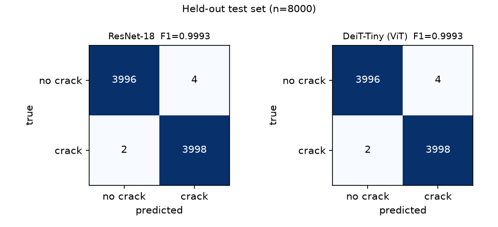
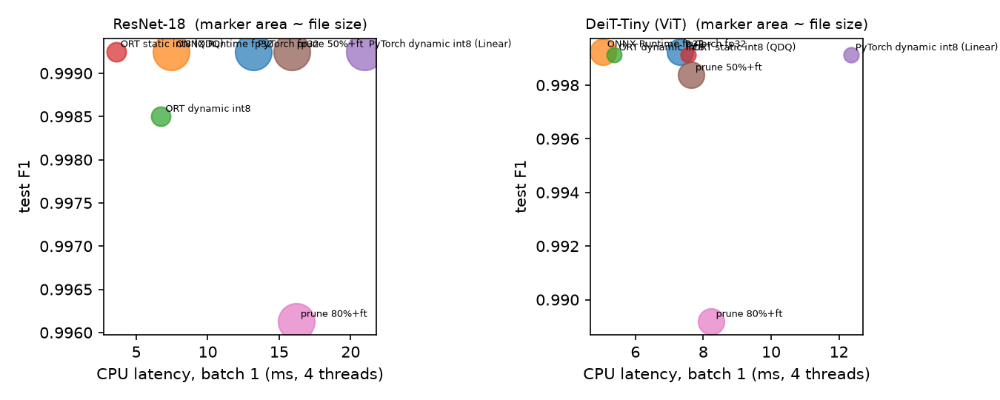
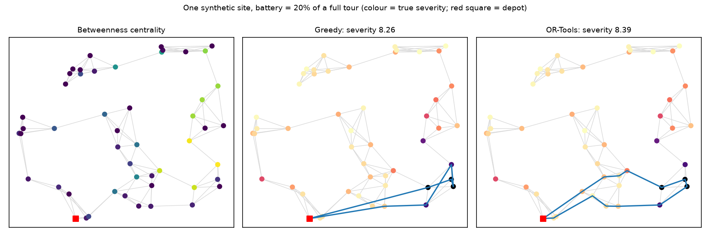

# Drone infrastructure inspection: crack detection → inspection graph → prioritised route

An end-to-end pipeline on **public data and synthetic site graphs**, all runnable on a laptop:

1. **Detect cracks** in image patches (ResNet-18 vs DeiT-Tiny, public concrete-crack dataset).
2. **Compress** both detectors (int8 quantization, magnitude pruning): accuracy vs size vs CPU latency.
3. **Place defects on an inspection-site graph**, prioritise waypoints (centralities, GNN) and **plan the route** (greedy + A* vs OR-Tools).

I built it in 2026 as a follow-up to my 2022 ENSTA Paris / U2IS internship on drone crack inspection (A* path planning with graph-centrality prioritisation, C++/ROS; a vision module was started there but not finished). **None of the numbers below come from that internship**: it used different data and code. Everything here was re-implemented and measured on public data; every figure comes from a script in this repo (`results/*.json` are the raw outputs).



## 1. Crack detection: CNN vs ViT

**Data.** [Concrete Crack Images for Classification](https://data.mendeley.com/datasets/5y9wdsg2zt/2) (Özgenel & Gönenç Sorguç, ISARC 2018; Mendeley Data, **CC BY 4.0**, no login): 40,000 RGB 227×227 patches (20k crack / 20k no-crack) cut from 458 photos of METU campus buildings. I first tried SDNET2018; its host returned HTTP 403 to scripted downloads, so I did not use it. `make data` downloads the archive, checks its SHA-256 and extracts it into `data/raw/` (git-ignored; files are only ever opened as images).

**Protocol.** Seeded stratified split of the 40k files: 70% train pool / 10% val / 20% test. Training uses a fixed 8,000-image subset of the train pool (4,000 per class); validation = 4,000 images; **test = 8,000 images, used once** after training, never for model selection (the epoch is picked on validation F1). Center-crop 224, random flips, ImageNet normalisation. Both models are ImageNet-pretrained (timm `resnet18.a1_in1k`, 11.2M params; `deit_tiny_patch16_224.fb_in1k`, 5.5M params), fine-tuned for 3 epochs with AdamW + one-cycle LR, batch 64, seed 0, on Apple MPS (M4 Pro). Training took 232 s (ResNet-18) and 100 s (DeiT-Tiny).

| Model | Precision | Recall | F1 | Accuracy | FP / FN (of 8,000) |
|---|---:|---:|---:|---:|---:|
| ResNet-18 | 0.9990 | 0.9995 | 0.9993 | 0.9993 | 4 / 2 |
| DeiT-Tiny (ViT) | 0.9990 | 0.9995 | 0.9993 | 0.9993 | 4 / 2 |

Precision/recall are for the crack class, single run (one seed). **The two models are indistinguishable here**: both make 6 errors out of 8,000, and a 2-error difference would not be significant anyway. The score is near the ceiling of this dataset, so it says little about which architecture is better and, more importantly, **should not be read as real-world accuracy** (see Limitations).

## 2. Compression: accuracy vs size vs CPU latency

All variants are scored on the same 8,000 test images. Latency = median wall-clock of one forward call on CPU (Apple M4 Pro, **4 threads**, 224×224, **batch 1 and batch 32**; 5 warm-up, 30 / 10 timed runs), model inputs pre-processed. Int8 variants: ONNX Runtime *dynamic* (weights int8), ONNX Runtime *static* (QDQ, per-channel, calibrated on 256 validation images), PyTorch dynamic quantization of `nn.Linear` layers (QNNPACK). Pruning: global L1 magnitude pruning of all conv/linear weights except the classifier, then 1 epoch of masked fine-tuning on the training subset (rows without fine-tuning are shown for reference).

**ResNet-18**

| Variant | File MB | gzip MB | Test F1 | FP/FN | ms, bs 1 | ms, bs 32 |
|---|---:|---:|---:|---:|---:|---:|
| PyTorch fp32 | 44.8 | – | 0.9993 | 4/2 | 13.2 | 424 |
| ONNX Runtime fp32 | 44.7 | – | 0.9993 | 4/2 | 7.5 | 246 |
| ORT dynamic int8 | 11.2 | – | 0.9985 | 9/3 | 6.7 | 205 |
| **ORT static int8 (QDQ)** | **11.3** | – | **0.9993** | 4/2 | **3.6** | **107** |
| PyTorch dynamic int8 (Linear only) | 44.8 | – | 0.9993 | 4/2 | 20.9 | 986 |
| prune 50%, no fine-tune | 44.8 | 25.0 | 0.9947 | 1/41 | – | – |
| prune 50% + fine-tune | 44.8 | 25.0 | 0.9993 | 5/1 | 15.9 | 426 |
| prune 80%, no fine-tune | 44.8 | 12.9 | 0.0252 | 4/3949 | – | – |
| prune 80% + fine-tune | 44.8 | 12.9 | 0.9961 | 18/13 | 16.2 | 438 |

**DeiT-Tiny**

| Variant | File MB | gzip MB | Test F1 | FP/FN | ms, bs 1 | ms, bs 32 |
|---|---:|---:|---:|---:|---:|---:|
| PyTorch fp32 | 22.2 | – | 0.9993 | 4/2 | 7.3 | 122 |
| ONNX Runtime fp32 | 22.3 | – | 0.9993 | 4/2 | 5.0 | 146 |
| ORT dynamic int8 | 6.0 | – | 0.9991 | 5/2 | 5.4 | 136 |
| ORT static int8 (QDQ) | 6.2 | – | 0.9991 | 5/2 | 7.6 | 175 |
| PyTorch dynamic int8 (Linear) | 6.3 | – | 0.9991 | 5/2 | 12.3 | 270 |
| prune 50%, no fine-tune | 22.2 | 12.5 | 0.9394 | 1/456 | – | – |
| prune 50% + fine-tune | 22.2 | 12.5 | 0.9984 | 10/3 | 7.6 | 133 |
| prune 80%, no fine-tune | 22.2 | 6.7 | 0.3323 | 3243/2557 | – | – |
| prune 80% + fine-tune | 22.2 | 6.7 | 0.9892 | 19/67 | 8.2 | 135 |



What it shows (and what it does not):

- **Int8 cuts file size ~4× at essentially no accuracy cost** for both models (≤ 5 more test errors than fp32 on 8,000 images; not statistically distinguishable). For ResNet-18, *static* int8 in ONNX Runtime was also the fastest variant: 3.6 ms vs 7.5 ms (ORT fp32) and 13.2 ms (PyTorch fp32) at batch 1.
- **Int8 did not speed up DeiT-Tiny** on this CPU (5.0 → 5.4–7.6 ms at batch 1 in ORT; slower for static int8). Quantize/dequantize overhead around attention and LayerNorm probably dominates, but I did not profile it. At batch 32 PyTorch fp32 (122 ms) beat ORT fp32 (146 ms) for the ViT.
- **PyTorch dynamic quantization only touches `nn.Linear`**: for ResNet-18 that is just the classifier, so size and accuracy are unchanged and it is slower. It is listed as a baseline, not as a recommendation.
- **Unstructured pruning does not make dense inference faster or the file smaller**: latency is unchanged and the raw file stays the same size (zeros are stored). Only compressed storage (gzip column) shrinks. Pruning without fine-tuning is destructive at 80%; with one epoch of fine-tuning the CNN keeps F1 0.996 at 80% sparsity and the ViT 0.989.
- Latency numbers on a laptop CPU are noisy: repeated runs of the same ResNet-18 ORT static variant gave 2.7–3.6 ms at batch 1 while other processes were or were not running. Treat differences below ~30% as noise. Single seed, no confidence intervals.

## 3. Planning: graph analysis, greedy + A*, OR-Tools

**Graph analysis** (`priority.py`, `baselines.py`): degree, betweenness, closeness (length-weighted) and PageRank (1/length weights) of the site graph, plus a combined priority = 0.7 × (defect evidence smoothed over neighbours) + 0.3 × normalised betweenness. **A\*** (Euclidean heuristic, admissible because edge lengths ≥ Euclidean distance) is tested to match Dijkstra; the greedy nearest-neighbour tours use it to expand every leg into a waypoint path (the greedy itinerary planner itself reads a precomputed all-pairs distance matrix).

**Solvers** (`routing.py`, OR-Tools routing with guided local search):
- *orienteering*: pick waypoints to inspect so that collected severity is maximal under a battery limit (travel + inspection + return); optional multi-drone;
- *TSP*: shortest closed tour through a set of priority nodes;
- *cover-VRP*: visit a set of nodes with ≤ 4 battery-limited drones, minimising total length.

**Benchmark** (`make planning`; 30 fresh synthetic sites with 50–80 waypoints, seed 123; solvers are given the *true* severities, so only the routing algorithm is compared). Lengths are in unit-square units. OR-Tools runs use a **fixed time limit** (2 s orienteering, 1 s TSP), and guided local search spends all of it, so its runtime column is the limit, not time-to-solution.

| Task | Greedy + A* | OR-Tools | Notes |
|---|---:|---:|---|
| Orienteering, battery 10% of tour: severity found | 2.78 | 2.79 (+0.1%) | OR-Tools ≥ greedy on 22/30 sites |
| Orienteering, battery 20% | 8.46 | 8.97 (+6.0%) | 22/30 sites |
| Orienteering, battery 30% | 12.93 | 13.45 (+4.0%) | 17/30 sites |
| Runtime, orienteering | 0.1 ms | 2,000 ms (limit) | greedy uses a precomputed distance matrix |
| TSP over the 15 highest-severity nodes: route length | 3.95 (nearest neighbour) | 3.58 (−9.5%) | runtime 0.3 ms vs 1,000 ms (limit) |
| Cover-VRP, top-15 nodes, 4 drones with battery 25% of a full tour | – | feasible on 26/30 sites; 1.69 drones on average; total length 4.52 | one unlimited drone: 3.41 |
| Exact check: 10 candidate nodes, battery 8%, 28 instances | 99.4% of optimum | **100.0% of optimum on all 28** | optimum by exhaustive DP |

OR-Tools was **worse than greedy on a minority of sites** (8/30 at 20% battery) within its 2 s limit, so it is a strong but not guaranteed-better heuristic at this size; it matches the exact optimum on the small instances I could verify. The greedy planner is ~4 orders of magnitude faster. Both finish in well under a second of *useful* time on 50–80 nodes, so the choice is about quality, not feasibility. Example (one site, 20% battery):



## 4. Connecting everything: detector → graph → priorities → route

`make pipeline` (`pipeline.py`). The synthetic survey prior of the GNN study is replaced by **detector evidence**: for each surveyed waypoint (about 60%) the drone takes 4 photos; each photo shows a crack with probability severity / max severity of that site, **the photo itself is a real patch drawn from the held-out crack dataset pool**, and the waypoint's evidence is the fraction of those 4 patches that the trained ResNet-18 flags as cracked. Test sites draw from the **test** pool (patches the detector never saw); train/val sites draw from the validation pool. The coupling "site severity → what the photo shows" is a simulation assumption of mine; the images and the detector's errors on them are real. A GCN (same architecture and training as Part A, with this detector evidence as the prior feature) is then compared with simpler priorities.

Each ranking drives (i) the greedy planner at 10/20/30% battery and (ii) the OR-Tools orienteering solver at 20% (1 s limit). **Values are % of the collected severity of the OR-Tools solution given the true severities** at the same battery (a reference, not a proven optimum; values above 100 are possible). Mean ± std over 3 seeds × 40 unseen test sites per seed.

| Priority source | ndcg@10 | spearman | greedy@10% | greedy@20% | greedy@30% | OR-Tools@20% |
|---|---:|---:|---:|---:|---:|---:|
| GCN on detector evidence | 0.818 ± 0.005 | 0.704 ± 0.009 | 88.2 ± 1.8 | 90.1 ± 2.8 | 93.1 ± 1.7 | 88.8 ± 3.5 |
| Detector evidence + betweenness | 0.784 ± 0.012 | 0.793 ± 0.008 | 87.6 ± 3.0 | 86.9 ± 0.6 | 91.3 ± 2.3 | 88.3 ± 2.2 |
| Detector evidence only | 0.723 ± 0.021 | 0.501 ± 0.003 | 79.0 ± 3.2 | 79.3 ± 3.3 | 78.5 ± 3.5 | 88.2 ± 4.0 |
| Betweenness centrality | 0.551 ± 0.003 | 0.594 ± 0.003 | 75.1 ± 1.5 | 71.2 ± 2.9 | 75.7 ± 3.8 | 84.9 ± 2.7 |
| Closeness centrality | 0.477 ± 0.029 | 0.413 ± 0.006 | 73.4 ± 4.5 | 76.6 ± 1.5 | 78.2 ± 1.5 | 80.6 ± 2.6 |
| Random | 0.305 ± 0.007 | 0.015 ± 0.044 | 66.3 ± 4.1 | 58.1 ± 3.5 | 61.3 ± 3.6 | 77.3 ± 2.2 |

- With the greedy planner the ranking matters a lot: GCN-on-detector-evidence finds 90.1% at 20% battery vs 71.2% for betweenness alone and 58.1% for random.
- With the OR-Tools planner the gaps **shrink**: random scores already reach 77.3% and the best ranking 88.8%. A stronger route optimiser recovers much of what a poor ranking loses, because it fits more waypoints into the battery. The three evidence-based rows are within one std of each other there, so I do not claim a winner under OR-Tools.
- The centralities carry no defect evidence; as in Part A, the comparison with them mixes "more information" and "better method". The "Detector evidence + betweenness" row is a non-learned way to use both.

## Part A: GNN waypoint ranking on synthetic sites (original study)

This project trains a graph neural network to rank the inspection waypoints a drone should visit on a structure, and compares it with the centrality rankings used before. Each ranking drives the same battery-limited greedy planner.

### Results (GNN study)

The test set has 200 unseen sites per seed. Values are the mean ± std over 5 seeds (0–4); for each seed, metrics are first averaged over its test sites. The table is sorted by defects found at the 20% budget.

- **found@B%**: true defect severity collected by the greedy itinerary when the battery equals B% of a full-site tour. It is shown as a % of the same planner fed the *true* severities. That reference is a greedy one, not an optimal tour.
- **ndcg@10** and **spearman** measure how well each method ranks waypoints against the hidden true severity.

| Method | ndcg@10 | spearman | found@10% | found@20% | found@30% |
|---|---:|---:|---:|---:|---:|
| GCN (ours) | 0.752 ± 0.005 | 0.619 ± 0.007 | 86.5 ± 1.7 | 90.0 ± 1.0 | 89.6 ± 1.4 |
| GAT (ours) | 0.728 ± 0.010 | 0.583 ± 0.006 | 85.8 ± 2.8 | 88.3 ± 1.0 | 88.7 ± 1.7 |
| Neighbour-smoothed prior | 0.725 ± 0.009 | 0.485 ± 0.005 | 78.7 ± 2.2 | 81.0 ± 2.2 | 82.7 ± 2.0 |
| Personalized PageRank (prior) | 0.668 ± 0.008 | 0.468 ± 0.004 | 78.7 ± 2.0 | 80.7 ± 1.1 | 82.8 ± 1.0 |
| MLP, no graph (ablation) | 0.656 ± 0.008 | 0.501 ± 0.011 | 81.6 ± 1.9 | 79.9 ± 2.7 | 80.9 ± 1.3 |
| Closeness centrality | 0.481 ± 0.012 | 0.434 ± 0.012 | 73.8 ± 2.4 | 75.5 ± 1.9 | 77.4 ± 1.0 |
| Survey prior only | 0.642 ± 0.007 | 0.338 ± 0.005 | 75.4 ± 2.7 | 74.1 ± 2.2 | 74.3 ± 0.9 |
| Betweenness centrality | 0.555 ± 0.006 | 0.590 ± 0.008 | 78.6 ± 1.4 | 73.2 ± 1.1 | 74.8 ± 1.2 |
| Degree centrality | 0.390 ± 0.005 | 0.257 ± 0.008 | 72.1 ± 2.9 | 69.6 ± 1.2 | 72.0 ± 1.7 |
| PageRank | 0.351 ± 0.009 | 0.137 ± 0.008 | 71.3 ± 1.9 | 68.7 ± 1.2 | 70.4 ± 1.0 |
| Random | 0.308 ± 0.010 | -0.002 ± 0.008 | 66.4 ± 3.7 | 61.5 ± 2.7 | 59.5 ± 1.1 |

What the table shows:

- **GCN against the best centrality baseline.** At the 20% budget, the GCN finds 90.0% of the reference defect severity. The best centrality ranking (closeness) finds 75.5%, a gain of 14.5 points. GCN leads at all three budgets and on NDCG@10. Its Spearman (0.619) is only slightly above betweenness (0.590).
- **A fairer comparison.** Centrality measures cannot see the survey prior, so part of that gap comes from information, not from learning. The fairer comparison is against non-learned methods that use the prior. Against the best of them, the GCN gains about 9 points at 20% (90.0 vs 81.0 for the neighbour-smoothed prior). GCN was ahead on every one of the 5 seeds (per-seed values in `results/results.json`).
- **Message passing matters.** An MLP with the same features and no edges reaches 79.9% at 20%, against 90.0% for the GCN.
- **GAT did not beat GCN** in this setup.

### Method (GNN study)

**Sites.** Each site has 50–80 waypoints in the unit square. Each waypoint is linked to its 4 nearest neighbours, and the Euclidean minimum spanning tree is added so the graph is connected. An edge's length is the Euclidean distance times U(1, 1.3), standing in for obstacles. Node 0 (the corner closest to the origin) is the depot.

**Hidden ground truth.** Each waypoint's defect severity is the sum of three parts:
- Cracks: 2–4 clusters, each a Gaussian bump over shortest-path distance.
- Load: 0.5 × normalised betweenness, so centrality carries real signal.
- Small noise.

**Observed node features (GNN input):**
- position (x, y);
- a noisy survey prior (normalised severity + N(0, 0.35)), available for about 60% of nodes and 0 elsewhere;
- a flag saying whether the survey covered the node;
- inspection cost;
- distance to the depot.

The true severity is never given as input.

**Models.** The models are built with PyTorch Geometric. Each has 3 GCNConv or GATConv layers (hidden size 64; GAT uses 4 heads) and a 2-layer MLP scoring head. They are trained by MSE regression on the true severity with Adam (lr 3e-3, batch 32, 150 epochs). The checkpoint with the best validation loss is kept. The data is split by **whole graphs**: 400 train / 100 val / 200 test sites per seed, so no test node is ever seen in training. Seeds are fixed.

**Planner.** The drone starts at the depot. It repeatedly flies to the unvisited waypoint with the best *score / (travel + inspection cost)*, as long as it still has enough battery to return. Travel uses shortest paths. An A* implementation with a Euclidean heuristic is included; it gives the same lengths as Dijkstra (tested), and the planner uses all-pairs Dijkstra for speed. Every ranking method goes through this exact planner. Budgets are 10/20/30% of a reference full-site tour (2 × MST length + all inspection costs).

**Baselines:**
- degree, betweenness, closeness (distance-weighted) and PageRank (1/length weights);
- the raw survey prior (missing values filled with the mean of the observed ones);
- the neighbour-smoothed prior: 0.5 × own prior + 0.5 × mean prior of the neighbours;
- personalized PageRank seeded by the prior;
- random.

### Limits (GNN study)

- **Synthetic data.** I designed the defect generator, so the results show that the method works when defects are spatially clustered and partly observed. They are not evidence about real structures. The 0.5 betweenness weight and 0.35 survey noise are arbitrary choices, and different choices would change the size of the gaps.
- **Unequal information.** The centrality baselines do not use the prior. The prior-based baselines are there to separate "uses more information" from "learns better".
- **Greedy reference.** The reference planner is a greedy one fed perfect scores, not an optimal orienteering solution. Values above 100% would therefore be possible; none occurred in the means.
- **Narrow tuning.** Only GCN and GAT were tried, with no hyperparameter search.

## Architecture & cost choices

- **Everything runs on one laptop (Apple M4 Pro, 12 cores, MPS GPU), with no cloud and no paid service.** Fine-tuning a pretrained 5–11M-parameter classifier on 8,000 patches takes 2–4 minutes on MPS; the whole GNN study takes ~6 minutes on CPU; OR-Tools solves 50–80-node sites in seconds on one core. Renting a GPU would add cost and data-transfer steps without changing any conclusion at this scale.
- **Small models and a subset by design.** Pretrained ResNet-18 / DeiT-Tiny, 3 epochs, 8k of 28k available training images: the dataset is easy and the goal is a comparison under a fixed small budget, not a leaderboard.
- **Edge-style deployment is the point of section 2.** A drone companion computer is a small CPU/NPU box; int8 ONNX Runtime models are 4× smaller and (for the CNN) ~2–4× faster on CPU. I did not run on such hardware: latencies are from the laptop CPU limited to 4 threads.
- **Planning is cheap.** Greedy + A* takes ~0.1 ms per site, OR-Tools a fixed 1–2 s; both are CPU-only and can run on the drone or a ground station.
- **Reproducibility.** Fixed seeds (data split, training, sites), pinned split logic, raw dataset checksum-verified, `data/raw/`, caches and checkpoints git-ignored.

## Limitations

- **The crack scores are optimistic.** The 40k patches are crops of only 458 photos, and I split *randomly by patch*, so near-identical neighbouring patches can land in train and test. Both models score F1 0.9993 and compression barely moves it, which is what a saturated, leaky benchmark looks like. The dataset has no photo IDs, so I could not split by source photo. This is a clean-concrete patch classifier, not a validated field crack detector; no cross-dataset test (e.g. on road or bridge images) was run.
- **One seed, one split** for the vision experiments: no confidence intervals; the 6-error difference between any two near-ceiling models is noise.
- **Compression**: latencies are from a laptop CPU at 4 threads, noisy, not from drone hardware; no hardware-specific int8 kernels or NPU were tried; unstructured pruning gives no dense speed-up; pruning was done once per sparsity with a single fine-tuning epoch and no tuning.
- **The detector → graph link is simulated** (how photos relate to hidden severity, 4 patches per waypoint, 60% survey coverage). The sites are synthetic and generated by me; results show the pipeline works under those assumptions, not that it would work on a real structure.
- **Solvers**: OR-Tools is a local-search heuristic with a time limit, verified optimal only on small (10-candidate) instances; the "reference" in section 4 is an OR-Tools run, not a proven optimum. Single-drone, static, 2-D, no obstacles/wind/battery model beyond a distance budget.
- GNN-specific limits are listed under Part A.

## Reproduce

```bash
make setup                       # uv venv + editable install
make data                        # download METU concrete-crack set (CC BY 4.0) into data/raw/ (needs bsdtar for .rar)
make train compress              # ~6 min + ~20 min on an M4 Pro (MPS for training; CPU for latency)
make planning pipeline gnn       # ~6 min + ~20 min + ~6 min
make figures test                # reports/*.png; 31 pytest tests
```

Layout: `src/gnn_inspect/crack/` (data, models, train, compress, predict, download), `routing.py` (OR-Tools solvers), `priority.py`, `planner.py` (A*, greedy itinerary), `baselines.py`, `model.py` (GNN), `pipeline.py`, `bench_planning.py`, `experiment.py` (Part A), `figures.py`. Results: `results/` (JSON + tables), figures: `reports/`.
